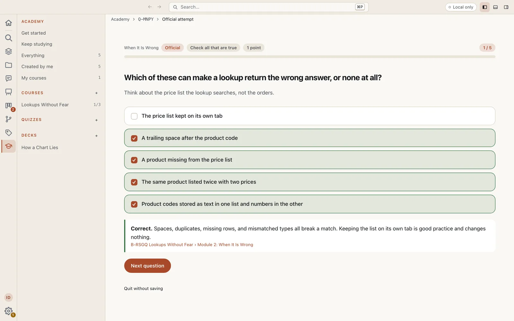
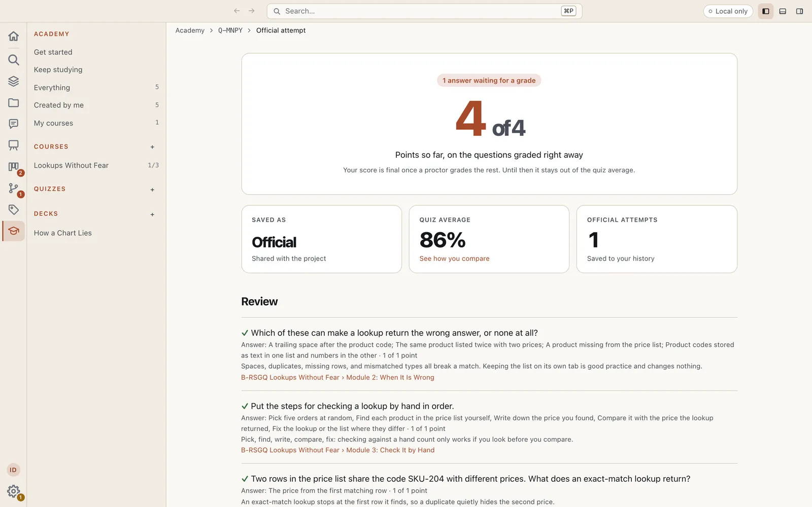
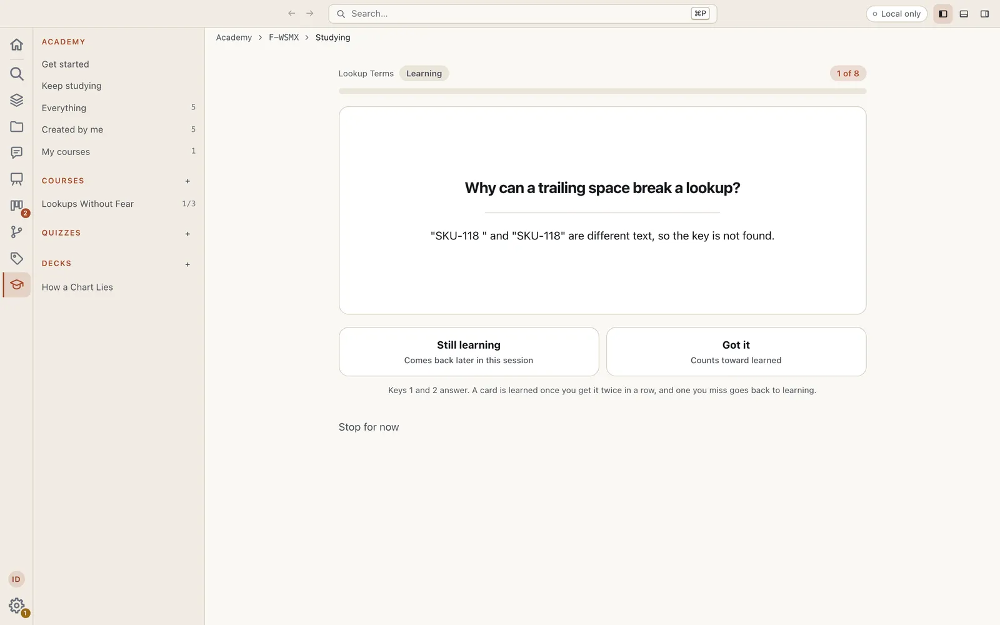
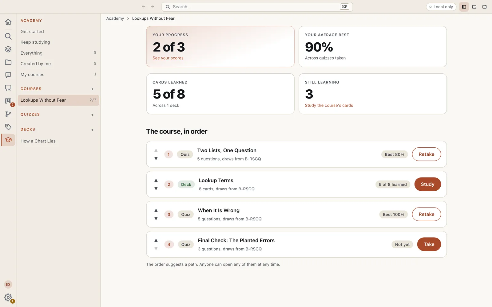
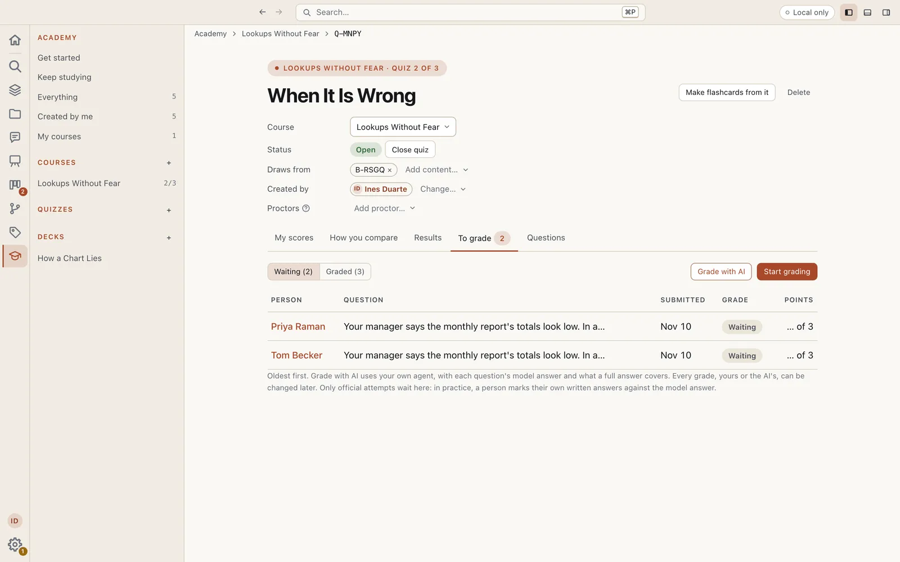

# Academy for Eidos MD

Turn your project's content into quizzes and flashcard decks, group them into courses, and see how everyone is doing. Practice on your own, take a quiz officially for the record, and study a deck a little at a time, whenever you like. A plugin for [Eidos MD](https://eidosmd.com) from The Virtual Panda.



## What it does for you

- **Build a quiz from anything in your project**: a blueprint, an asset, or a link. Your own AI agent writes the questions, you regenerate the ones you don't like, or you write them yourself. Every question has its answer and the reason why, and can link to the section it comes from.
- **Seven types of question**: multiple choice, true or false, check all that are true, short answer, put in order, match, and written answer. Make a question worth more points, give it a passage or a hint to read alongside, or add an image from your assets. Questions and options are shuffled for each attempt unless you turn that off.
- **Learn while you answer.** The moment you check an answer you see whether it is right and why, and the result reviews every question with its explanation.
- **Grade written answers** on a quiz's To grade tab. The person sees the model answer as soon as they submit, and their score is final once a proctor grades it. Grade with AI has your own agent grade every waiting answer, its grades counting at once or waiting for you to review.
- **Build a deck of flashcards** the same ways, or make one from a quiz you already have: each question becomes a card, with its answer and why on the back.
- **Study at your own pace.** Flip a card and answer Got it or Still learning. A card is learned once you get it twice in a row. Each session brings the cards you are still learning first, then new ones, then the learned ones you studied longest ago. Nothing comes due, and nothing nags you.
- **Keep studying** shows every deck with how many cards you have learned and when you last studied it, and studies across all of them at once.
- **Keep a quiz, a deck, or a course just for you.** Pick **Just me** when you make one and it stays on your machine: nobody else sees it or your scores, and taking it is one **Take quiz** button whose attempts count as your scores. Share it with the project whenever you like, and take a shared one back while nobody else has history with it.
- **Group quizzes and decks into courses**, in one order, or keep either as a one-off. The order suggests a path and locks nothing.
- **Enroll in a course** to follow your progress across it: which quizzes you have taken and every score. Anyone can enroll, a course's creator and proctors too, and the people who run a course see how everyone enrolled is doing.
- **See your scores over time**, and how you compare with a quiz's average. A quiz's creator, the proctors they add, and the project's owners see everyone's results, down to each answer. Where you stand in a deck is yours alone.
- **Open as soon as it has a question or a card.** Close a quiz or a deck to keep working on it, and try it out yourself meanwhile.
- **Add a study plan if you want one.** `/study-plan` in Chat has your agent write reading sessions for a book, a textbook, or online content, as ordinary blueprints in your project.

## A closer look

After an official attempt you get your score, the quiz average, and a review of every question with its answer and why. A written answer shows the model answer right away and waits for a grade.



A deck shows one card at a time. Flip it, then say whether you got it.



A course keeps its quizzes and decks in order, with your progress and your best scores beside each one.



The To grade tab lists the written answers waiting for a grade. Start grading walks through them one at a time, or Grade with AI hands them to your agent.



## Get started

1. In Eidos MD, open **Settings**, then **Community plugins**, and press **Browse**.
2. Find **Academy**, press **Install**, then **Enable**.
3. Open **Academy** from the activity bar (the graduation cap). A project with nothing in Academy yet opens on **Get started with Academy**; you can open it again any time from **Get started** in the sidebar.
4. Pick **A quiz**, **A deck**, or **A course**, and press **Continue**. Give it a title, then choose what it draws from: the blueprints, assets, and links its questions or cards come from.
5. Choose **Generate with AI** (your agent writes them in Chat, from what it draws from) or **Write them myself**, then press **Create quiz**, **Create deck**, or **Create course**. On the next screen, press **Generate your questions** or **Write your questions** (cards, for a deck).
6. To try a quiz, open it and press **Take officially**, or practice first with **Whole quiz**, **Retry missed**, or **Not yet seen**. To study, press **Study** beside a deck in its course or on **Keep studying**. To follow a course, open it and press **Enroll**.

Later, **New quiz**, **New deck**, and **New course** on Academy's list start more, **Make flashcards from it** on a quiz turns it into a deck, and **Build a study plan** on a course asks your agent for reading sessions.

## Requirements

- Eidos MD 0.18.0 or later.
- To generate questions or cards, or to grade with AI: the AI Agent plugin switched on, with your own agent. Everything else works without one.

## Practice and official attempts

| What                                                                      | Where it is kept                          | Shared?           |
| ------------------------------------------------------------------------- | ----------------------------------------- | ----------------- |
| One-off quizzes and decks                                                 | `academy/<title>.md`                      | Committed         |
| A course and its quizzes and decks                                        | `academy/<course>/`                       | Committed         |
| Official attempts, deck sessions, enrollments, grades                     | `.eidos/plugins/academy/results/<alias>/` | Committed         |
| Practice attempts, sessions with no name                                  | `.eidos/plugins/academy/local/`           | This machine only |
| Quizzes, decks, and courses just for you, and their attempts and sessions | `.eidos/plugins/academy/local/academy/`   | This machine only |
| Lessons, wiki pages, study plans                                          | Your project's own collections            | Yours             |

Practice stays on your machine, never shared and never counted, and so does everything you keep just for yourself. An official attempt is shared with the project and kept in your history, and so are your sessions with a deck, so your progress follows you to any machine. A quiz and a deck are markdown files you can read and edit by hand.

Scoring runs on good faith. What each person is shown is a soft permission, not security: the answer key and committed results are files anyone with the project can read.

## Sharing a quiz by a public link

On Eidos online, or a team's own server, **Share** on a quiz makes a link anyone can take it from, with no account, once Eidos has reviewed this version of Academy and the project's owner has turned on public links for it. A guest gives their name as the quiz asks (**Guests give their name** on its Questions tab: required, optional, or not asked), answers one question at a time with each answer checked as they give it, and sees their score at the end. The answers never reach their browser: Eidos checks each one against the quiz's key.

Guests' attempts land on the quiz's **Guests** tab, live, apart from the project's people, and count in no score, average, or course. Open one to see every answer, grade a guest's written answers on **To grade** beside everyone else's, and **Remove** an attempt, or every attempt from one link, when you're done with it.

## Coming from Quizzes

Academy was called Quizzes before 0.3.0. In a project that used Quizzes, Academy's list offers **Move them into Academy** to a project owner. Every quiz, course, result, and enrollment moves over with the same ids.

## From the terminal

Install and switch it on:

```bash
eidos plugin install @The-Virtual-Panda/academy
eidos plugin enable academy
eidos plugin allow academy
```

`eidos academy --help` lists the commands for quizzes, decks, courses, and grading, and `eidos instructions academy` is the guide your agent follows. Moving from Quizzes: `eidos academy move-quizzes --dry-run` says what would move, `eidos academy move-quizzes` moves it and names the framework command that removes the empty old folder, and `eidos plugin disable quizzes` switches the old plugin off.

To work on Academy itself, the source is at [The-Virtual-Panda/eidos-academy](https://github.com/The-Virtual-Panda/eidos-academy). A checkout builds against an `eidosmd` checkout beside it (`../eidosmd/cli`): `pnpm install`, `pnpm test`, and `pnpm dev`, then `eidos plugin dev dist` serves it in a sandbox project that touches none of your own.
